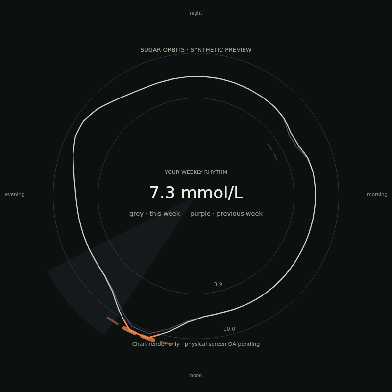

# Orbit Focus v2 — Rhythm display + iPhone companion

**Version:** 0.10.0-prototype · 16 November 2026  
**Status:** implemented prototype on `feature/orbit-focus-v2`; not automatically
installed on the Pi, not a validated medical product.

The goal is occasional, useful reflection at home—not another live CGM monitor.
Choose one recurring part of your day, name a habit yourself, capture context on
the phone, and come back to a gentle seven-day review.

## What works in this build

| Page | Purpose |
| --- | --- |
| `/` | Existing v1 visual interface, preserved |
| `/rhythm` | New round 800×800 layout: Rhythm → 7 days → Focus |
| `/phone` | iPhone logging, habits/check-ins, review and food notes |
| `/rhythm?demo=1` | Explicit synthetic, non-writing preview |
| `/phone?demo=1` | Explicit synthetic preview; saving is disabled |

Both real pages read the same Pi database. The visible display refreshes every
30 seconds; Dexcom collection remains every five minutes. Returning to the page
also refreshes it. There is no continuous rendering loop or new cloud service
needed for the core features.

The demo is generated in memory and never inserted into the real archive.

## Round display

**Rhythm:**

- Grey curve: arithmetic mean of matching clock-time bins across the most recent
  **seven completed calendar days** in `APP_TIMEZONE`.
- Purple ghost: the seven days immediately before that.
- Thin purple circles: 3.9 and 10.0 mmol/L.
- Coloured curve portions are clipped at those actual radial boundaries.
- Separate orange / blue arcs outside / inside the range show high / low
  frequency, even when the average remains in range. They are not glucose-value curves.
- A two-hour clock wedge quietly identifies the current period, not your current reading.
- Event satellites show activity (mint), stress (purple), other (hollow white),
  and food (pale green). Today is stronger; older retained events are faint.
- Touch the orbit area to inspect that half-hour's mean, observed high/low
  percentages, and number of covered days. Release to return to the global view.

**7 days:** today's partial day plus the six preceding dates, as separate rings.
Touch/hover selects by radial proximity, not a narrow hit on an actual line.
Move inward/outward to change day; move around to inspect time and nearest value.
The centre keeps that day's time in range and coverage visible. Release restores
all rings, mean and time in range. A gap is a gap, never an invented value.

**Focus:** shows the single user-chosen habit and time sector, check-in count,
and review-ready state. It links conceptually to the phone, where choices happen.

Swipe changes mode. On the daily-ring page, start swipes in the centre or outer
margin so radial probing and page navigation do not fight one another. Visible
mode buttons are retained as a fallback for physical-screen testing.

Safe shutdown is still loopback-only, requires the existing installer/flag, and
uses a dedicated power symbol: hold four seconds to open, then hold two seconds
to confirm. Normal swipes do not open it. This does not protect against arbitrary
power removal; safely shut down before unplugging.

### Synthetic chart preview



This image is produced with the actual canvas drawing code in a DOM test harness.
It is not a photograph or a pixel-verified screenshot of the physical Pi.

## Phone flow

1. Open `/phone` on your Pi's private web address.
2. Tap Activity, Stress, or Other to mark now. Undo is available for ten seconds.
3. Use “Add a note or earlier event” for backdating or a short optional note.
4. Open Focus, inspect candidate windows, or choose your own clock window.
5. Name your habit, or choose “Simply observe this period”.
6. Check in with Done / Partly / Not today. An unanswered day stays unknown.
7. After seven days, review the baseline and focus week and add a subjective
   reflection. Continue as a fresh week, or stop. Nothing assigns a grade.

The first-week baseline is frozen at selection time. Renewal saves a new baseline
and replaces the active focus atomically. A failed renewal leaves the original active.
Review reflections do not create fake habit-completion entries.

There are **no background push notifications in this version**. A due review
appears on the next visit and on the wall display. iOS background syncing is not
assumed: unsent tags retry when you reopen the page or the connection returns
while the page is running.

## Exact analysis rules

- UTC is authoritative for sample/event identity. `Europe/Berlin` is the default
  presentation/analysis timezone, independent of the browser's travelling timezone.
- Readings are deduplicated into five-minute UTC slots before analysis.
- A half-hour profile bin requires at least 70% of its expected slots on each day,
  and three eligible days before a weekly mean is drawn.
- Eligible daily means are equally weighted; days with denser sampling do not
  dominate the weekly profile.
- The previous week uses exactly the same method. No prior data means no ghost.
- DST days have their actual 23- or 25-hour slot counts; repeated hours do not
  silently count as duplicate data, and nonexistent hours are not fabricated.
- Candidate periods use eight fixed, non-overlapping three-hour windows.
- A day counts as affected only after at least three consecutive observed
  five-minute out-of-range samples, with no large intervening gap.
- A candidate needs at least three affected, sufficiently covered days. This is
  an app heuristic, **not Dexcom's proprietary pattern algorithm** or a validated
  statistical-significance test.
- Above: `>10.0`; below: `<3.9`; range is inclusive `3.9–10.0`.
- Percentages describe covered observations, not assumed values during gaps.
- A focus comparison uses only complete selected clock windows after the habit
  started and before its seven-day review time. It never compares an incomplete
  current afternoon against a whole baseline afternoon.
- At least five covered days in each period are needed before the app marks an
  early comparison as sufficiently covered. This is a product gate, not clinical validation.
- A week is an early observation, not proof of causality. Selection of an unusually
  difficult baseline, missing data, weekday differences, illness and many other
  factors can change the result. Both time-above and time-below remain visible.

## Retention and privacy

- Existing glucose collection/35-day archive is unchanged. The extra week already
  supports four selectable weeks plus the previous-week comparison.
- The separate `context.sqlite3` retains at most **20 event tags**, no older than
  **28 days**; oldest events are removed as new ones arrive.
- Habit check-ins, focus baselines and reflections are separate and pruned at 28
  days. The 20-tag cap does not discard a habit check-in.
- Unsent events/deletions stay in this phone's localStorage, at most 28 days.
  Device/browser backups or storage clearing are outside the app's control.
- Deletion is retried by ID so a lost network response does not resurrect an
  apparently unsent event. Requests have UUIDs to avoid retry duplicates.
- Local retention removes active SQLite rows; it is **not forensic secure erasure**
  of an SD card or of independent backups.
- The service worker caches only the public app shell/assets, never private
  API replies, glucose records, event logs, photos or authentication responses.
- Use a device passcode. Another person holding an unlocked phone can read
  unsent local tags and an already authenticated app.

## Network setup — no automatic security changes

The existing Pi defaults to `HOST=127.0.0.1`. That works on the Pi only; the
iPhone cannot reach it directly. Installing this branch **does not change that**.

For the phone, prefer a private HTTPS connection (for example a separately
configured private VPN/proxy). Do not port-forward 8787 or expose this beta to
the public internet. The HTTP server here is not an internet-facing production
authentication service. HTTPS should terminate at the trusted reverse proxy;
preserve the original Host header for same-origin checks.

Required locally in `.env` for **any non-loopback companion access**:

```ini
APP_ACCESS_CODE=your-private-passphrase
APP_SESSION_SECRET=a-long-random-private-secret
APP_TIMEZONE=Europe/Berlin
```

Generate the session secret locally, not in chat:

```bash
.venv/bin/python -c 'import secrets; print(secrets.token_urlsafe(48))'
```

If intentionally testing on a trusted isolated home LAN without HTTPS, the
existing opt-in flags are `HOST=0.0.0.0` and `ALLOW_LAN_PREVIEW=true`. This is a
**plaintext development preview**, including the access code and health data;
the passphrase does not encrypt traffic. Keep it behind your firewall, and do
not relax Safari HTTPS protections just to reach it. Prefer private HTTPS for
daily use, and configure that separately before relying on the phone companion.

Open `/phone`, follow its Unlock link, and enter the private app access code on
that phone. Session cookies remain HTTP-only and same-site. New write endpoints
also require a per-process CSRF token and same-origin requests. Restarting the
service invalidates that CSRF token; reload the page before saving again.

Add to Home Screen using Safari's Share menu. Secure-context service workers
support the offline shell; ordinary `http://sugarorbits.local` does not have
service-worker/offline reload guarantees. Open tabs can still queue event tags.

## Optional AI: what it actually does

The guide works without AI and explicitly labels itself **Local guide · not AI**.
It selects questions from deterministic pattern evidence. This first version is
not a free-form medical chatbot.

Cloud wording sends only pattern counts and habit-completion counts. It sends
no raw CGM traces, Dexcom credentials, event notes or user-written habit text.
It asks one short reflective question, which must pass an additional habit-only
wording check. All statistics remain local and are displayed separately.

To enable the optional bridge, set these privately on the Pi:

```ini
ORBIT_AI_ENABLED=true
OPENAI_API_KEY=your-private-API-key
ORBIT_AI_MODEL=your-selected-compatible-model
```

Use a Responses API model with image input and strict structured-output support.
API usage may incur charges according to your account; no paid requests run at
startup or on a timer. Enable only with an intentional budget/rate limit in the
provider account. There is one in-flight request and a 30-second per-feature
cooldown. A checkbox grants per-request consent in the phone interface.

Requests use `store:false`, but **that is not a claim of zero retention**. Provider
logging and retention policies still apply. The app has no API key configured
by default, and live cloud quality has not been tested with your account.

Official implementation references:

- [Image input and its limitations](https://developers.openai.com/api/docs/guides/images-vision)
- [Structured outputs](https://developers.openai.com/api/docs/guides/structured-outputs)

## Food-photo exploration

This is an **experimental draft workflow**, not a dosing aid:

1. Take or choose an image. No upload happens automatically.
2. The phone resizes it to at most 1024 px and re-encodes JPEG, stripping EXIF.
3. Describe the known portion/weight or recipe. A photograph cannot reliably
   establish weight, hidden sauces, ingredients or carbohydrate content.
4. Explicitly consent to send that image and note to OpenAI.
5. The provider returns item-by-item broad ranges and assumptions, or asks for
   more information. Refusals, timeouts and invalid numeric ranges produce no saved estimate.
6. Verify using portion weight, labels or other reliable information. Enter your
   independently checked number in a separate field and confirm before saving.

No automatic midpoint is chosen or filled into the confirmed-food field. No
insulin, carbohydrate ratios, boluses, or pump adjustments are calculated.

The **no-AI label calculator** is available now: portion grams × label carbs per
100 g ÷ 100. Match cooked/dry weight and use the label's carbohydrate definition;
the app does not subtract fibre automatically. Only your confirmed food note
and grams are saved as an event, never the image. API calls hold the image only
for the current request; the external provider's policies still apply.

## Install without replacing v1

From PowerShell, connect as usual:

```powershell
ssh YOUR_PI_USER@YOUR_PI_HOST
```

Replace those placeholders with your own Pi login and hostname. Then on the **Pi**:

```bash
cd ~/sugarorbits
git status --short
```

If that reports local source changes, stop; preserve them before switching.
Do not discard `.env` or the `.data` directory. With a clean source tree:

```bash
git fetch origin
git switch feature/orbit-focus-v2
.venv/bin/python -m pip install -r requirements.txt
sudo systemctl restart sugar-orbits
```

The old `/` screen is still the autostart default. Open these on the Pi first:

- `http://127.0.0.1:8787/rhythm`
- `http://127.0.0.1:8787/phone`

Use `?demo=1` only for synthetic visual previews. Do not expect demo tags to save.
To use `/rhythm` after every boot, edit only the URL at the end of the existing
Chromium command in your user's `.config/labwc/autostart`. Do not append another
kiosk process, remove the screen-sleep block, or change display drivers/wiring.
The installed two-minute sleep/touch-wake behavior is otherwise unchanged.

To return to the previous edition, with no uncommitted source changes:

```bash
cd ~/sugarorbits
git switch main
sudo systemctl restart sugar-orbits
```

Restore the kiosk URL to `/` if you changed it. The new context archive stays
local and is ignored by the v1 code; rollback does not erase glucose history.

## Verification / remaining work

Automated checks completed:

- 40 Python unit/HTTP tests, including DST, data gaps, coverage, deduplication,
  frozen baseline, retention, reflection separation, CSRF/origin protection,
  authorization, original routes, and optional AI disabled/consent behavior.
- Existing JavaScript art geometry and gesture regression tests.
- DOM + real-HTTP workflow: quick tag → shared Pi state → focus → check-in →
  label arithmetic → confirmed food log → offline queue/undo → ring hover.
- JavaScript syntax and Python compilation checks.

Run the core tests:

```bash
.venv/bin/python -m unittest discover -s tests -v
node --test tests/test_art.cjs
```

`tests/focus_dom.cjs` additionally needs development-only `jsdom` and
`@napi-rs/canvas`, invoked through `tests/run_focus_dom.py`. The optional real
browser test `tests/focus_browser.cjs` needs Playwright, an installed Chromium,
and `tests/serve_focus_fixture.py`. None of those tools are needed on the Pi.

**Pending:** physical Pi layout/touch/swipe/shutdown, actual iPhone Safari camera,
Add to Home Screen, offline service-worker behavior, private HTTPS provisioning,
live model responses/food-estimation quality, and a real seven-day usability trial.
The development sandbox blocked launching a real browser, so DOM/canvas checks
must not be mistaken for on-device visual or clinical validation.
